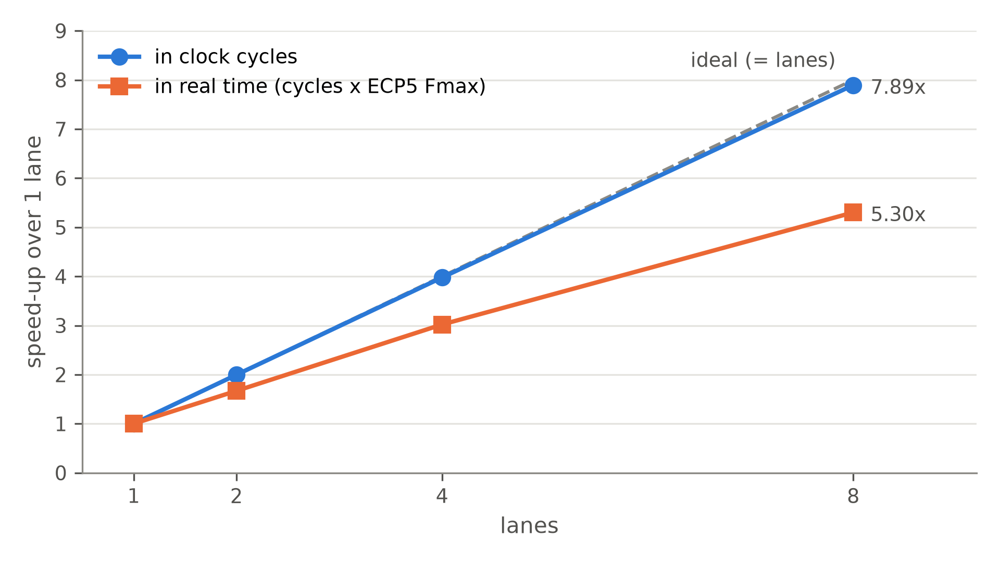
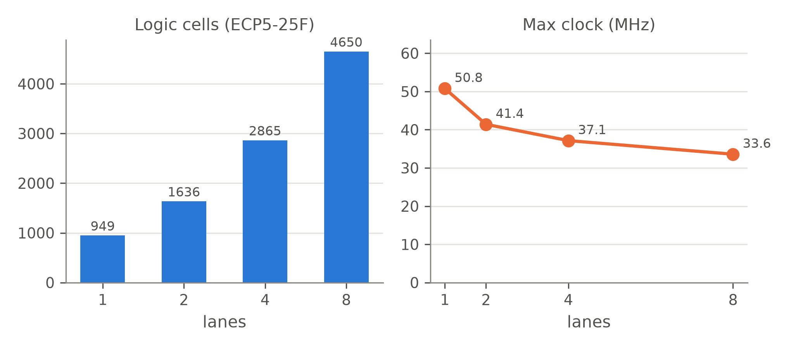

# SIMD Vector Processing Unit

[](https://github.com/mahir-m01/SIMD-Vector-Processing-Unit/actions/workflows/ci.yml)
[](rtl)
[](https://steveicarus.github.io/iverilog/)
[](https://www.veripool.org/verilator/)
[](https://github.com/YosysHQ)
[](syn)
[](LICENSE)


A parameterised SIMD vector processing unit in Verilog: eight 16-bit lanes, a 48-instruction ISA (14 ALU jobs in three forms, plus 6 for memory and control), cycle-exact verification against a Python golden model, and a measured scalar-versus-SIMD comparison on FPGA.

## Overview

Image filters, audio, neural networks and physics codes repeat the same arithmetic over long arrays. A scalar processor fetches, decodes and runs one instruction per element. A **SIMD** (Single Instruction, Multiple Data) processor runs one instruction on a whole group of elements at once: one control decision drives several calculators ("lanes") working side by side.

This project builds such a unit, checks it thoroughly, and measures what it gains. Setting the lane count to 1 turns the same design into an ordinary scalar processor. The scalar baseline therefore runs the **same program** with the **same instructions** and the **same timing rules**, and any difference comes from data-level parallelism alone.

## Objectives

- Design a SIMD unit with the blocks named in the brief: vector register file, parallel ALUs, vector control unit, lane MUXes, result combiner and a scalar interface.
- Support vector ADD, SUB, AND, OR, XOR, comparisons, shifts, multiply, min and max, plus a dot-product reduction.
- Verify every lane and every instruction with self-checking testbenches and a golden model.
- Compare scalar and SIMD versions of the same workloads: cycle count, throughput and speed-up.
- Report FPGA resource use and maximum clock frequency for 1, 2, 4 and 8 lanes.

## Architecture

<p align="center"></p>

| Block | File | Role |
| --- | --- | --- |
| Vector control unit | [`vec_control_unit.v`](rtl/vec_control_unit.v) | Decodes instructions, chooses the next PC, adds the extra cycle for loads |
| Vector register file | [`vec_regfile.v`](rtl/vec_regfile.v) | 8 × 128-bit registers, 2 read + 1 write port |
| Scalar register file | [`scalar_regfile.v`](rtl/scalar_regfile.v) | 8 × 32-bit registers, `s0 = 0`, debug port for the host |
| Lane MUX | [`lane_mux.v`](rtl/lane_mux.v) | Operand B per lane: vector element or broadcast scalar |
| Parallel ALUs | [`vec_alu_lane.v`](rtl/vec_alu_lane.v), [`vec_alu_array.v`](rtl/vec_alu_array.v) | 8 copies of a 14-operation 16-bit ALU |
| Result combiner | [`result_combiner.v`](rtl/result_combiner.v) | Lane results as a vector, plus an adder-tree sum for reductions |
| Core / FPGA top | [`simd_core.v`](rtl/simd_core.v), [`fpga_top.v`](rtl/fpga_top.v) | Integration and performance counters; block-RAM memories and board pins |

- **One instruction per clock cycle.** Loads take two cycles, because block RAM answers one clock after the address. Branches cost nothing extra. So cycles = instructions + loads, exactly.
- **128-bit vectors**: the width of Intel SSE and ARM NEON.
- **Compares write all-ones masks**, so an `if` can run without a branch.

Full walkthrough: [`docs/architecture.md`](docs/architecture.md) · instruction set: [`docs/isa.md`](docs/isa.md) · block notes: [ALUs](docs/alu.md), [register files](docs/register_files.md), [lane MUX and combiner](docs/lane_mux_and_combiner.md)

```asm
loop:   VLD  v1, A(s1)        # load 8 elements of A
        VLD  v2, B(s1)        # load 8 elements of B
        VADD v3, v1, v2       # 8 additions in one instruction
        VST  v3, C(s1)
        ADDI s1, s1, 1
        BNE  s1, s2, loop
```

## Phase 1 results

The full write-up is the [Phase 1 report](reports/Phase1_Report.pdf); [`reports/references.md`](reports/references.md) lists the papers it builds on.

### Scalar versus SIMD

Each kernel processes N = 256 random sixteen-bit elements (full range). Every cycle count below was measured on the RTL and matches the golden model's prediction exactly; the counts do not depend on the data.

| Kernel | What it computes | 1 lane | 2 lanes | 4 lanes | 8 lanes | Speed-up |
| --- | --- | --- | --- | --- | --- | --- |
| vadd | `C = A + B` | 2,051 | 1,027 | 515 | 259 | **7.92×** |
| saxpy | `Y = a·X + Y` | 2,308 | 1,156 | 580 | 292 | **7.90×** |
| relu | `Y = max(X, 0)` | 1,539 | 771 | 387 | 195 | **7.89×** |
| threshold | `Y = X if X ≥ T else 0` | 2,053 | 1,029 | 517 | 261 | **7.87×** |
| dot | `Σ A·B` | 2,052 | 1,028 | 516 | 260 | **7.89×** |

- **Near-ideal in cycles.** Eight lanes need 7.87–7.92× fewer cycles. The small gap is the few set-up instructions and `HALT`, which run once whatever the lane count (Amdahl's law).
- **Throughput.** Vector add moves from 0.12 to 0.99 elements per cycle.

<p align="center"></p>

### FPGA: Lattice ECP5-25F after place-and-route

The FPGA build is loaded with `isa_test`, the program that uses every instruction, so the synthesis tools cannot remove any part of the processor.

| Lanes | Logic cells | Multipliers | Block RAM | Fmax (median of 3 seeds) |
| --- | --- | --- | --- | --- |
| 1 | 1,555 (6.4%) | 1 | 2 | 43.3 MHz |
| 2 | 1,943 (8.0%) | 2 | 3 | 36.2 MHz |
| 4 | 3,720 (15.3%) | 4 | 5 | 32.9 MHz |
| 8 | 5,396 (22.2%) | 8 | 9 | 29.1 MHz |

- **Cost.** Each lane adds one hardware multiplier and about 550 logic cells on average. Eight lanes cost 3.5× the logic of one, because control, scalar registers and memories are shared.
- **Clock.** The single-cycle datapath gets longer with more lanes, so the estimated Fmax drops from 43.3 to 29.1 MHz.
- **Real speed-up.** 7.89 × (29.1 / 43.3) = **5.3×** faster in wall-clock time at 8 lanes. Pipelining (Phase 2) targets the lost clock speed.
- **Artix-7 (Basys-3) estimate.** 2,731 LUTs (13%) and 8 DSP48 for 8 lanes, one per lane. Details and the Vivado flow: [`syn/`](syn).

<p align="center"></p>

### Verification

| Level | What is checked | Result |
| --- | --- | --- |
| Lane ALU | 14 operations × corner values, every shift amount, carry isolation, 2,000 random vectors per op | 225,496 lane checks, 0 errors |
| Register files | both ports, write enable, read-during-write, `s0 = 0`, debug port, random | 10,044 checks, 0 errors |
| Lane MUX + combiner | broadcast, adder tree vs plain loop, extremes; 1, 2, 4 and 8 lanes | 44,032 checks, 0 errors |
| Full system | 6 programs × 4 lane counts: every memory word, scalar and vector register, instruction and cycle count, plus 50 cycles after `HALT` | 24 / 24 runs match |
| Directed corner tests | writes to `s0`, address and PC wrap-around, back-to-back loads, a branch into a load, wide broadcast, every unused op code, `BNE` on bits 16 and 31, unused fields, code after `HALT`; 4 lane counts | 12 / 12 runs match |
| Board version | `fpga_top` with its block RAM, loaded with `isa_test`, started by its power-on reset alone; 4 lane counts | registers, LEDs and all 1,024 memory words match |
| Random programs | `sw/fuzz.py`: every op code, random branches, addresses and data, RTL against the golden model; 25 per lane count in `make test`, 1,000 in `make fuzz` | 4,000 / 4,000 match |
| Mutation tests | injected bugs in the ALU, adder tree, sign extension, load timing, branches, `HALT`, stray register writes and FPGA stores | all caught |

The test plan is in [`tb/README.md`](tb/README.md).

## Reproducing the results

Requires [Icarus Verilog](https://steveicarus.github.io/iverilog/), [Verilator](https://www.veripool.org/verilator/) and Python 3.10+. Synthesis also needs [Yosys](https://github.com/YosysHQ/yosys) and nextpnr-ecp5 (`pip install yowasp-nextpnr-ecp5`). The figures need [uv](https://github.com/astral-sh/uv).

```bash
brew install icarus-verilog verilator yosys      # macOS; on Ubuntu: apt install iverilog verilator yosys
make test      # lint, unit testbenches, Python checks, full-system and random runs (about 15 s)
make perf      # scalar vs SIMD for 1, 2, 4, 8 lanes      -> results/perf.csv
make syn       # ECP5 place-and-route + Artix-7 estimate  -> results/fpga_*.csv (about 4 min)
make plots     # results/figures/*.png
make report    # reports/Phase1_Report.pdf (needs tectonic)
```

To view waveforms: `python3 sw/run_workloads.py --workloads vadd --vcd`, then open `build/sim/vadd_L8/wave.vcd` in GTKWave or [Surfer](https://surfer-project.org).

## Repository structure

```text
SIMD-Vector-Processing-Unit/
├── rtl/                  synthesizable Verilog: core, lanes, register files, control, FPGA top
├── tb/                   self-checking testbenches and the verification plan
├── sw/                   assembler, golden model, workload programs, runner, plots, tests
│   └── programs/         vadd, saxpy, relu, threshold, dot, isa_test
├── syn/                  FPGA synthesis sweep (ECP5, Artix-7) and the Vivado flow for Basys-3
├── results/              perf.csv, fpga_ecp5.csv, fpga_artix7.csv and figures
├── docs/                 architecture, instruction set and one page per hardware block
├── reports/              Phase 1 report (PDF and LaTeX source) and references
├── .github/workflows/    lint and tests on every push and pull request
└── Makefile              make test | perf | syn | plots | report
```


## Report and video

- **Phase 1 report:** [`reports/Phase1_Report.pdf`](reports/Phase1_Report.pdf) (IEEE format; LaTeX source in [`reports/src`](reports/src))
- **Prototype video:** link will be added here after recording

## Roadmap

| Phase | Focus |
| --- | --- |
| Phase 1 (done) | RTL, verification, scalar-vs-SIMD cycle comparison, ECP5 resources and Fmax |
| Phase 2 | Pipelined core for higher Fmax; exact Vivado results and a Basys-3 board run; masked (predicated) execution and saturating arithmetic; speed-up against problem size; power estimates; final report |

## References

Key works this project builds on (full list in [`reports/references.md`](reports/references.md)):

> Flynn, M. J. (1972). Some computer organizations and their effectiveness. *IEEE Transactions on Computers*, C-21(9), 948–960.

> Yiannacouras, P., Steffan, J. G., and Rose, J. (2008). VESPA: Portable, scalable, and flexible FPGA-based vector processors. *Proc. CASES*, 61–70.

> Cavalcante, M., Schuiki, F., Zaruba, F., Schaffner, M., and Benini, L. (2020). Ara: A 1-GHz+ scalable and energy-efficient RISC-V vector processor. *IEEE Transactions on VLSI Systems*, 28(2), 530–543.

## Acknowledgements

Developed as a semester project. Simulation with Icarus Verilog, lint with Verilator, synthesis and place-and-route with Yosys and nextpnr (Project Trellis for ECP5).
