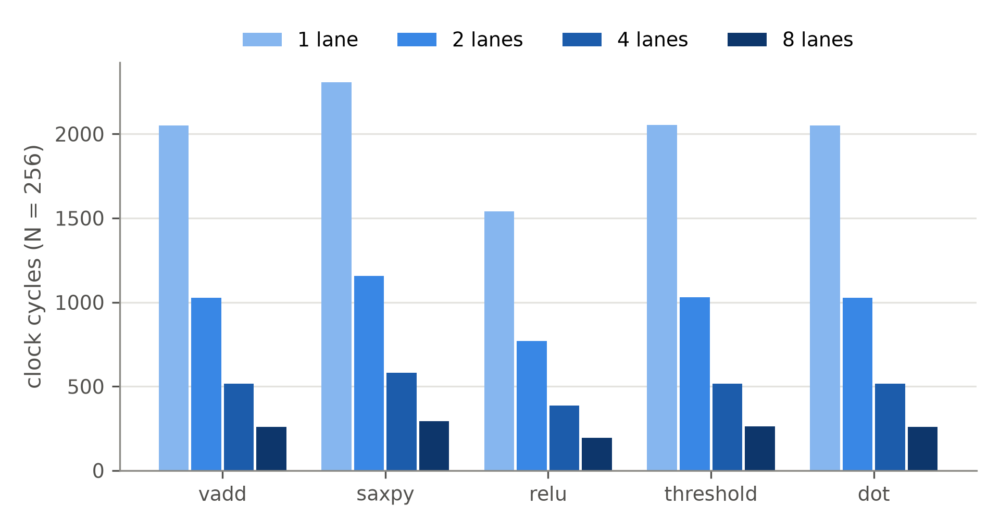

# Software: assembler, golden model and workloads

Writing programs as raw 32-bit numbers is slow and error-prone, and the hardware needs something to be checked against. This folder provides both.

| File | What it is |
| --- | --- |
| [`vasm.py`](vasm.py) | The **assembler**. It turns text like `VADD v3, v1, v2` into the 32-bit words the hardware runs. Labels, comments and constants such as `ITER` or `B+1` are allowed; constants may only use whole numbers, names and plain arithmetic, so a program can never run other code. It reports mistakes with the line number. |
| [`golden.py`](golden.py) | The **golden model**: a Python description of what every instruction does. It runs the same machine code and predicts the final memory, the registers, the instruction count and the exact cycle count. |
| [`run_workloads.py`](run_workloads.py) | Runs every workload on the golden model and on the Verilog core, checks both, and writes the cycle counts to `results/perf.csv`. |
| [`directed_tests.py`](directed_tests.py) | Small hand-built programs for the corner cases (wrap-around, unused op codes, branches on high bits, code after `HALT`). |
| [`fuzz.py`](fuzz.py) | Random programs: makes up programs with every op code and random data, and checks the Verilog core against the golden model on each. |
| [`plot_perf.py`](plot_perf.py) | Draws `results/figures/cycles.png` and `speedup.png`. |
| [`programs/`](programs) | The workloads, written in assembly. |
| [`tests/test_vasm.py`](tests/test_vasm.py), [`tests/test_golden.py`](tests/test_golden.py) | Self-checks for the assembler (encodings, branch offsets, errors, every program assembles) and the golden model. |

## Workloads

Each benchmark processes N = 256 random sixteen-bit numbers, over the full range from −32768 to 32767 (`isa_test` uses 32). The loop runs N / LANES times, so the same file is both the scalar version (1 lane, 256 passes) and the SIMD version (8 lanes, 32 passes).

| Program | Computes | Why it is a good test |
| --- | --- | --- |
| [`vadd.s`](programs/vadd.s) | `C[i] = A[i] + B[i]` | The simplest data-parallel loop. |
| [`saxpy.s`](programs/saxpy.s) | `Y[i] = a·X[i] + Y[i]` | Classic BLAS kernel; uses a scalar broadcast to every lane. |
| [`relu.s`](programs/relu.s) | `Y[i] = max(X[i], 0)` | The activation function of most neural networks. |
| [`threshold.s`](programs/threshold.s) | `Y[i] = X[i] if X[i] ≥ T else 0` | An `if` without a branch: compare, flip the mask, AND. |
| [`dot.s`](programs/dot.s) | `Σ A[i]·B[i]` | Uses `VDOT`: multiply in the lanes, add up in the result combiner. Each product keeps its low 16 bits, as with `VMUL`. |
| [`isa_test.s`](programs/isa_test.s) | every instruction | Coverage: all 14 ALU jobs in all three forms on random data. |

## Commands

```bash
python3 sw/run_workloads.py                              # all workloads, 8 lanes, golden model + RTL
python3 sw/run_workloads.py --lanes 1 2 4 8 --csv results/perf.csv
python3 sw/run_workloads.py --no-rtl                     # golden model only (no Verilog tools needed)
python3 sw/vasm.py sw/programs/vadd.s -o vadd.hex -D A=0 -D B=256 -D C=512 -D ITER=32
python3 -m unittest discover -s sw/tests -v
```

## Results

<p align="center"></p>

| Workload | 1 lane (cycles) | 8 lanes (cycles) | Speed-up |
| --- | --- | --- | --- |
| vadd | 2,051 | 259 | 7.92× |
| saxpy | 2,308 | 292 | 7.90× |
| relu | 1,539 | 195 | 7.89× |
| threshold | 2,053 | 261 | 7.87× |
| dot | 2,052 | 260 | 7.89× |

The speed-up is just under 8 because a few instructions run only once, whatever the lane count: the setup before the loop and the final `HALT`. That fixed part does not shrink with more lanes. This is Amdahl's law: speed-up is limited by the part of the work that cannot be done in parallel.
