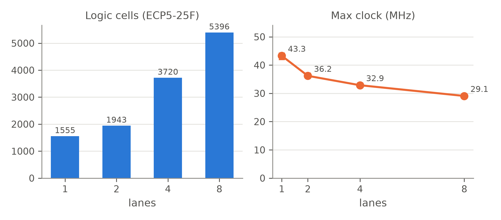

# FPGA synthesis: size and speed

Simulation proves the design is *correct*. Synthesis shows what it *costs* on a real chip (how much of the FPGA it uses) and how *fast* it can run (the maximum clock frequency, Fmax).

## Targets

| FPGA | Board examples | Tools | Gives |
| --- | --- | --- | --- |
| Lattice **ECP5-25F** (LFE5U-25F, speed 6) | ULX3S, OrangeCrab, Colorlight | Yosys + nextpnr (open source) | resources **and** Fmax after place-and-route |
| Xilinx **Artix-7 xc7a35t** | Basys-3, Arty A7 | Yosys `synth_xilinx` | resource estimate |
| Xilinx Artix-7, exact | Basys-3 | Vivado: [`vivado/build.tcl`](vivado/build.tcl) | exact resources and Fmax (needs Vivado; to run in the lab) |

The design is built for every lane count (1, 2, 4, 8) with `isa_test` already loaded in its memories. `isa_test` is the program that runs every instruction. This matters: the instruction memory is read-only, so the synthesis tools look at the program in it and remove any logic it can never use. With a program that left some instructions out, the design would look smaller and faster than the real processor.

Before each build, `run_syn.py` simulates that exact board version ([`tb/tb_fpga_top.v`](../tb/tb_fpga_top.v)), started only by its power-on reset, and stops unless the selected register, the LEDs and every data-memory word match the golden model. Place-and-route picks a random starting point, so each ECP5 build is placed 3 times with different seeds and the median Fmax is reported. Fmax is nextpnr's estimate from its static timing analysis (no pin constraints), not a measurement on a board.

The board version (`rtl/fpga_top.v`) adds three things to the core: 1,024 words of data memory (the same as in simulation, so every program fits), a power-on reset that holds the core for 15 clocks after the FPGA is programmed, and a two-flip-flop synchroniser on the reset button.

## Commands

```bash
pip install yowasp-nextpnr-ecp5        # or install nextpnr-ecp5 from your package manager
python3 syn/run_syn.py                 # about 4 minutes -> results/fpga_ecp5.csv, results/fpga_artix7.csv
python3 syn/run_syn.py --board-only    # just the board simulation, a few seconds (part of make test)
uv run --python 3.12 --with matplotlib python syn/plot_fpga.py     # results/figures/fpga_scaling.png

# In the lab, with Vivado installed. --board-only makes the memory files and needs only iverilog:
python3 syn/run_syn.py --board-only --lanes 8
vivado -mode batch -source syn/vivado/build.tcl -tclargs 8
```

## Results

<p align="center"></p>

**Lattice ECP5-25F, after place-and-route** (`results/fpga_ecp5.csv`)

| Lanes | Logic cells (of 24,288) | Flip-flops | Multipliers (of 28) | Block RAM (of 56) | Fmax, median of 3 seeds |
| --- | --- | --- | --- | --- | --- |
| 1 | 1,555 (6.4%) | 16 | 1 | 2 | 43.3 MHz |
| 2 | 1,943 (8.0%) | 16 | 2 | 3 | 36.2 MHz |
| 4 | 3,720 (15.3%) | 16 | 4 | 5 | 32.9 MHz |
| 8 | 5,396 (22.2%) | 16 | 8 | 9 | 29.1 MHz |

**Xilinx Artix-7 xc7a35t, Yosys estimate** (`results/fpga_artix7.csv`). The design is flattened first, as the ECP5 flow does, so every cell is counted once.

| Lanes | LUTs (of 20,800) | LUTs used as RAM | Flip-flops | DSP48 (of 90) | Block RAM 36K (of 50) |
| --- | --- | --- | --- | --- | --- |
| 1 | 548 | 22 | 42 | 1 | 0.5 |
| 2 | 864 | 28 | 42 | 2 | 1 |
| 4 | 1,483 | 38 | 42 | 4 | 2 |
| 8 | 2,731 | 60 | 43 | 8 | 4 |

## What the numbers say

* **Area grows with the lanes, but less than 8×.** Each lane adds its own ALU and one hardware multiplier (one DSP block per lane on both FPGAs). The parts shared by all lanes (control unit, scalar registers, memories) are paid once, so 8 lanes cost 3.5× the logic of 1 lane, not 8×.
* **The register files sit in LUT RAM, not flip-flops.** Yosys stores the vector and scalar registers in the FPGA's small distributed memories (the "LUTs used as RAM" column). The 16 ECP5 flip-flops are the program counter, the load and halt flags, and the reset logic.
* **The clock gets slower with more lanes**: 43.3 MHz at 1 lane, 29.1 MHz at 8. The longest path runs through one clock cycle in full: instruction out of block RAM → register read → lane ALU (usually the multiplier) → adder tree → scalar register. Wider designs also spread out on the chip, so the wires get longer, and more lanes mean a deeper adder tree.
* **Real speed-up is therefore lower than cycle speed-up.** 8 lanes take 7.89× fewer cycles but run at 0.67× the clock, so the program finishes 5.3× sooner in real time. Pipelining the core (Phase II) would recover most of the lost clock speed.

## Files

| File | Purpose |
| --- | --- |
| [`run_syn.py`](run_syn.py) | Runs the sweep and writes the two CSV files. |
| [`plot_fpga.py`](plot_fpga.py) | Draws the scaling figure. |
| [`vivado/build.tcl`](vivado/build.tcl), [`vivado/basys3.xdc`](vivado/basys3.xdc) | Vivado flow and pin map for the Basys-3 board. Not yet run (no Vivado on the development machine). The Basys-3 clock is 100 MHz, above the expected Fmax, so a slower clock (clock divider or MMCM) is needed before running on the board. |
