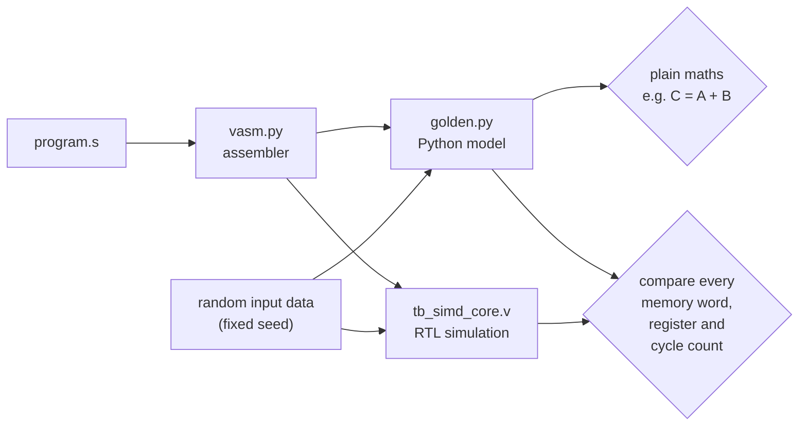

# Verification

Every block is tested on its own first (unit tests), then the whole processor runs real programs (system tests). Every test checks itself and prints `TEST PASSED` or `TEST FAILED`. Run them all with:

```bash
make test
```

## Test plan

| Level | Testbench | What it checks | Size |
| --- | --- | --- | --- |
| Unit | [`tb_vec_alu.v`](tb_vec_alu.v) | All 14 ALU jobs on 8 lanes against a separate integer model. All 64 pairs of 8 tricky values (0, 1, −1, 32767, −32768, …), every shift amount 0–23, no carry leaking between lanes, 2,000 random vectors per job, unused op codes give 0. | 225,496 lane checks |
| Unit | [`tb_regfiles.v`](tb_regfiles.v) | Vector and scalar register files: every register through both read ports, write-enable off, read-during-write, `s0` stays 0, debug port, 2,000 random cycles each. | 10,044 checks |
| Unit | [`tb_lane_combiner.v`](tb_lane_combiner.v) | Lane MUX in both modes; result combiner sum against a plain loop, with the extreme values (all lanes 32767 or −32768). Run for 1, 2, 4 and 8 lanes. | 11,008 checks × 4 |
| System | [`tb_simd_core.v`](tb_simd_core.v) | Whole programs on the full core. After `HALT` it keeps the clock running for 50 more cycles (no memory write is allowed), then compares all 1,024 data-memory words, all 8 scalar registers, all 8 vector registers, the instruction count and the cycle count with the Python golden model. Inputs are random over the full 16-bit range. | 6 programs × 4 lane counts |
| System | [`../sw/directed_tests.py`](../sw/directed_tests.py) | Corner cases on the same testbench: writes to `s0`, address and PC wrap-around, two loads in a row, a load right after a branch, store then load, a 32-bit scalar broadcast, reduces on compare results, every unused op code, `BNE` on numbers that differ only in bit 16 or bit 31, `VST`/`BNE`/`HALT` with their unused fields filled in, and instructions after `HALT` that must never run. | 3 programs × 4 lane counts |
| Board | [`tb_fpga_top.v`](tb_fpga_top.v) | The FPGA version with its block RAM, loaded with `isa_test` (every instruction) and started only by its power-on reset (no button press): `s7` on the LEDs and all 1,024 data-memory words must match the golden model. | 4 lane counts |
| System | [`../sw/fuzz.py`](../sw/fuzz.py) | Random programs on the same testbench: every op code, random fields, branches, addresses and memory contents. | 25 per lane count in `make test`; 1,000 in `make fuzz` |
| Software | [`../sw/tests/`](../sw/tests) | Assembler encodings worked out by hand, branch offsets, label and constant checks, error messages, every program assembles; golden-model corner cases and `s0` stays 0. | 11 tests |

## How the system test decides "correct"



There are two separate checks:

1. **Golden model vs plain maths.** This catches mistakes in the *program*. For example, the vector-add result must equal `[a + b for a, b in zip(A, B)]`.
2. **Hardware vs golden model.** This catches mistakes in the *hardware*. Memory, registers and timing must match exactly.

## Coverage

* **Instructions.** [`isa_test.s`](../sw/programs/isa_test.s) runs every vector–vector, vector–scalar and reduce instruction on random 16-bit data, plus `VDOT`, loads, stores, `ADDI`, `ADD`, `BNE` and `HALT`. Together with the five benchmark programs, all 48 instructions run on the real core.
* **ALU outcomes.** `tb_vec_alu` prints how many times each job was checked. It also fails if a compare job never produced both a true and a false answer.
* **Corner cases.** The directed programs cover what the benchmarks never do: wrap-around, back-to-back loads, branches into loads, unused op codes. They came out of an independent review of the design; the hardware and the golden model agreed on every one.
* **Lane counts.** Every system program runs with 1, 2, 4 and 8 lanes in `make test`, so lanes that exist in one build but not another are tested too.
* **The board version.** `make board` runs the FPGA top exactly as built, memories included, and checks the LEDs and every memory word.
* **Random programs.** [`sw/fuzz.py`](../sw/fuzz.py) makes up programs nobody wrote by hand: every op code, random fields (including the spare bit 16), random branches, addresses and memory. `make test` runs 25 per lane count and `make fuzz` runs 1,000 per lane count; the RTL and the golden model have agreed on every one (4,000 in the Phase 1 run, plus 1,200 with 8-bit elements).

## Do the tests actually catch bugs?

The tests were checked by breaking the design on purpose ("mutation testing"):

| Bug introduced | Caught by | Result |
| --- | --- | --- |
| `SRA` made a logical shift (sign not kept) | `tb_vec_alu` | mismatches on every negative input |
| Adder tree pairs the wrong lanes | `tb_lane_combiner` | 5,002 errors |
| Control unit forgets to wait for load data | `tb_simd_core` | every result word wrong |
| Combiner zero-extends instead of sign-extending (1 lane) | `tb_lane_combiner` | 2,507 errors |
| Core keeps running the instructions after `HALT` | `tb_simd_core` (`branch_halt`) | memory and register mismatches |
| `BNE` compares only the low 16 bits (or ignores bit 31) | `tb_simd_core` (`branch_halt`) | memory mismatches |
| `VST`, `BNE` or `HALT` also writes a vector register | `tb_simd_core` (vector registers) | vector register mismatches |
| FPGA top stores to the wrong address | `tb_fpga_top` (memory check) | every stored word wrong |

## Waveforms

To look at signals in GTKWave or [Surfer](https://surfer-project.org):

```bash
python3 sw/run_workloads.py --workloads vadd --lanes 8 --vcd
gtkwave build/sim/vadd_L8/wave.vcd
```
